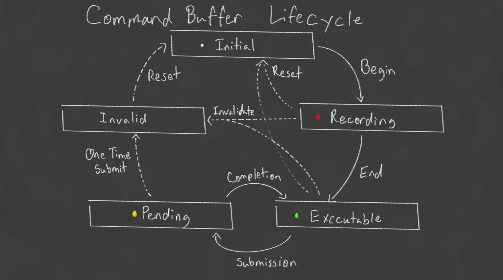

# 命令缓冲区

命令缓冲区 (Command Buffer) 是 Vulkan 中用于记录渲染命令的结构体

Vulkan 不允许直接执行命令，而是需要先将命令记录到命令缓冲区中，再通过提交命令缓冲区来执行

## 传统 API 的痛点

在 OpenGL 中，调用 `glDrawArrays()`，CPU 必须立刻停下来，把数据同步给 GPU，然后等 GPU 画完。这是一种极其低效的“同步”模式

Vulkan 为了让 GPU 跑满，采用了异步模式：

- 录制 (Recording)：CPU 拿着一个空白的本子 (Command Buffer)，在上面写：“第一步，清空屏幕；第二步，绑定管线；第三步，画 3 个顶点”。在这个阶段，GPU 甚至不知道你在干嘛，CPU 可以疯狂写
- 提交 (Submission)：CPU 写完后，把本子往“提交队列 (Queue)”里一扔
- 执行 (Executable/Pending)：GPU 自己从队列里拿本子，按照上面写的顺序一行行去执行，完全不需要 CPU 在旁边盯

这样做的最大好处是：CPU 和 GPU 彻底解耦了

CPU 在写下一个本子的同时，GPU 正在疯狂执行上一个本子，双方并行工作

## 概览



- `initial`：初始状态，可开始记录命令
- `recording`：正在记录命令，不可提交
- `executing`：正在执行命令，不可记录
- `pending`：已提交，等待执行
    - `pending` 状态下**不允许提交命令**
    - 必须先等待命令执行完成，才能提交新的命令缓冲区
- `invalid`：意味着这个 Command Buffer 采用提交一次 (One-Time Submit)，执行完直接废掉
    - 通常用于加载模型、上传纹理、拷贝显存

## 命令缓冲区创建 (createCommandBuffers)

命令缓冲区的创建分为**分配**和**记录**两个步骤

### 1. 分配命令缓冲区

为命令缓冲区分配内存

```cpp
VkCommandBufferAllocateInfo allocInfo{};
allocInfo.sType = VK_STRUCTURE_TYPE_COMMAND_BUFFER_ALLOCATE_INFO;
allocInfo.level = VK_COMMAND_BUFFER_LEVEL_PRIMARY;
allocInfo.commandPool = device.getCommandPool();
allocInfo.commandBufferCount = static_cast<uint32_t>(commandBuffers.size());
```

- `level`：命令缓冲区级别
    - `VK_COMMAND_BUFFER_LEVEL_PRIMARY`：主命令缓冲区，可直接提交到队列执行
    - `VK_COMMAND_BUFFER_LEVEL_SECONDARY`：次命令缓冲区，不能直接提交，只能被主命令缓冲区通过 `vkCmdExecuteCommands` 调用
        - 假设现在要渲染一个场景，里面有 10000 个物体
        - 如果全靠 CPU 主线程写在一本 PRIMARY 本子上，CPU 直接暴毙
        - 但如果开多线程 (这里假设4个线程)，每个线程拿一个 `SECONDARY` 缓冲区，疯狂并行录制“画 2500 个物体”的指令。录完后，主线程用 `vkCmdExecuteCommands` 把这四个次级本子合并到自己的 `PRIMARY` 本子里
            - 这4个渲染线程必须同时创建 4 个**独立的 `VkCommandPool`** (或者在分配时给 `VkCommandPoolCreateInfo` 加上 `VK_COMMAND_POOL_CREATE_RESET_COMMAND_BUFFER_BIT`)。让每个线程在自己的池子里分配和录制，做到物理隔离
- `commandPool`：命令池，命令缓冲区从命令池中分配
- `commandBufferCount`：分配的命令缓冲区数量，这里为交换链图像数量

```cpp
vkAllocateCommandBuffers(device.device(), &allocInfo, commandBuffers.data());
```

#### 为什么不能只用一个 Command Buffer？

既然命令缓冲区只是录制指令，那为什么不建一个全局的，每帧录制完直接提交？

因为竞态条件 (Race Condition)。假设只有一个，下一帧 CPU 开始重新录制时，上一帧 GPU 可能还没执行完，这就等于你在给正在跑的马拉松选手强改路线图，直接崩溃

正确的做法：通常我们会为每个交换链图像 (Image) 分配一个 Command Buffer（commandBufferCount = imageCount）。当从交换链拿到索引为 `i` 的图像时，我们就使用第 `i` 个 Command Buffer。这样能完美配合双/三缓冲机制，做到资源隔离

### 2. 记录命令

记录命令是在CPU端完成编写所有接下来所需执行的命令

对每个命令缓冲区，依次执行开始记录 → 记录渲染命令 → 结束记录

#### 开始记录

```cpp
VkCommandBufferBeginInfo beginInfo{};
beginInfo.sType = VK_STRUCTURE_TYPE_COMMAND_BUFFER_BEGIN_INFO;

vkBeginCommandBuffer(commandBuffers[i], &beginInfo);
```

调用 `vkBeginCommandBuffer` 后，命令缓冲区进入 `recording` 状态

#### 记录渲染通道

```cpp
VkRenderPassBeginInfo renderPassInfo{};
renderPassInfo.sType = VK_STRUCTURE_TYPE_RENDER_PASS_BEGIN_INFO;
renderPassInfo.renderPass = swapchain.getRenderPass();
renderPassInfo.framebuffer = swapchain.getFrameBuffer(i);
renderPassInfo.renderArea.offset = {0, 0};
renderPassInfo.renderArea.extent = swapchain.getSwapChainExtent();

std::array<VkClearValue, 2> clearValues{};
clearValues[0].color = {0.1f, 0.1f, 0.1f, 1.0f};
clearValues[1].depthStencil = {1.0f, 0};
renderPassInfo.clearValueCount = static_cast<uint32_t>(clearValues.size());
renderPassInfo.pClearValues = clearValues.data();

vkCmdBeginRenderPass(commandBuffers[i], &renderPassInfo, VK_SUBPASS_CONTENTS_INLINE);
```

- `renderPass`：渲染通道，定义了附件的加载/存储操作
- `framebuffer`：帧缓冲区，绑定对应的交换链图像
- `renderArea`：渲染区域，指定渲染范围
- `clearValues`：附件清除值，颜色附件清除为深灰色 `{0.1, 0.1, 0.1, 1.0}`，深度附件清除为 `1.0`
- `VK_SUBPASS_CONTENTS_INLINE`：表示子通道内容将直接记录在主命令缓冲区中，而非通过次命令缓冲区

#### 绑定管线与绘制

```cpp
pipeline->bind(commandBuffers[i]);
vkCmdDraw(commandBuffers[i], 3, 1, 0, 0);
```

- `pipeline->bind`：绑定图形管线到命令缓冲区
- `vkCmdDraw`：发出绘制命令，参数为 (vertexCount, instanceCount, firstVertex, firstInstance)，这里绘制 3 个顶点 (一个三角形)
    - **注意**: 所有以 `vkCmd` 开头的函数，都只是在给 GPU 填数据。此时 GPU 什么都没干。只有当调用了 `vkQueueSubmit`，把整套数据递过去时，GPU 才真正开始执行

#### 结束渲染通道与记录

```cpp
vkCmdEndRenderPass(commandBuffers[i]);
vkEndCommandBuffer(commandBuffers[i]);
```

- `vkCmdEndRenderPass`：结束渲染通道
- `vkEndCommandBuffer`：结束命令缓冲区记录，命令缓冲区回到可执行状态

## 命令缓冲区提交 (drawFrame)

```cpp
uint32_t imageIndex;
auto result = swapchain.acquireNextImage(&imageIndex);

result = swapchain.submitCommandBuffers(&commandBuffers[imageIndex], &imageIndex);
```

1. `acquireNextImage`：从交换链获取下一帧可用图像的索引
2. `submitCommandBuffers`：将对应的命令缓冲区提交到队列执行，并呈现到屏幕
    - **注意**: 录制可以无锁，但提交必须同步，否则会导致资源竞争

录制阶段 (CPU 写指令) 由于实现了多线程物理隔离，可以完全不加锁

但是，当你调用 `vkQueueSubmit` 把指令扔进 GPU 队列时，必须保证外部同步

如果多个线程同时向同一个 `VkQueue` 提交任务，GPU 会不知道先执行哪个，直接引发数据竞争 (Race Condition)，导致画面撕裂或驱动崩溃
