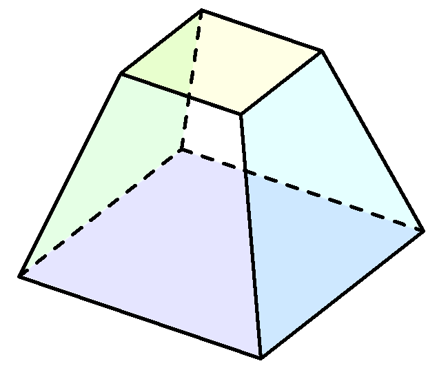
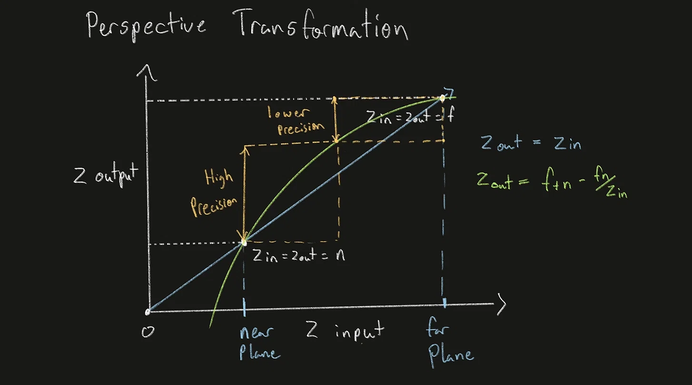

# 透视投影

我们的眼睛看到的图像是二维的，无论光子是从真实物体反射还是从屏幕显示，我们的神经回路处理几乎没有区别

所以我们的大脑已经处理了复杂的三维空间关系——通过一张2D图片和附近的信息，我们可以理解出物体的位置、大小和方向

为了可以将大量由三角形组成的3D模型**正确地**显示在二维的屏幕上，我们需要使用投影

我们可以想象成屏幕是一个窗口 (Window)，我们站在窗口内，窗口外摆着一张2D图片 (2D Image) 和光源

那么光的传播路径如下

```
观众 <- 窗口 <- 2D图片
```

那么在渲染照片时可以反过来，在观众的角度下将2D图片中的每个点映射到那个窗口上

```
观众 -> 窗口
```

那么只需要确定每个点的颜色，就可以渲染出3D场景了

这就是现代光线追踪技术即图像顺序渲染 (Image Order Rendering) 的核心思想，它优先考虑每个像素的颜色，然后再根据物体计算它对每个像素点的影响

而 Vulkan 采用了另外一种方式——对象顺序渲染 (Object Order Rendering)

假设现在有两个物体：一个汽车和一颗树，且树在汽车的前面

那么它处理顺序如下:

1. 先渲染汽车
2. 再渲染树
- 这样就能处理好树遮挡汽车的情况

## 投影

两种渲染顺序的差别只在于“先算哪个像素、先画哪个物体”，但每个顶点最终都要回答同一个问题：它该落在窗口的哪个位置

投影 (Projection) 就是回答这个问题的数学工具——把三维坐标压成二维坐标

透视投影 (Perspective Projection) 把三维空间中的点压到二维屏幕上，同时保留“近大远小”的规律，效果就像针孔相机 (Pinhole Camera) 成像：物体的像随距离增大而缩小，平行线在远处汇聚到消失点 (Vanishing Point)

[15.欧拉角和齐次坐标](../15.欧拉角和齐次坐标/README.md) 里的变换矩阵最后一行恒为 `[0, 0, 0, 1]`，`w` 永远是 1，所以它只能做仿射变换 (Affine Transformation)

投影矩阵的特别之处就在于**它改动 `w`**：让 `w` 等于深度，再在光栅化前用 `w` 做一次除法

```
ndc = clip.xyz / clip.w
```

这一步叫透视除法 (Perspective Divide)，“透视”两个字的全部效果都来自它

## 正交投影

正交投影 (Orthographic Projection) 是最简单的一种投影：平行线保持平行，物体远近不变

它本质上就是给每个轴配一个缩放和一个平移，把世界空间的一个长方体 (Box) 线性映射到 NDC 立方体

映射的终点在 Vulkan 里有个专门的名字——规范视体 (Canonical Viewing Volume)：

- X 轴范围：[-1, 1] (向右为正)
- Y 轴范围：[-1, 1] (向下为正)
- Z 轴范围：[0, 1] (从近平面 0 到远平面 1，采用深度区间 [0, 1]，类似于 DirectX)
- 手性：右手坐标系 (X 指向右，Y 指向下，Z 指向屏幕内部)

两者的关系是：规范视体是 Vulkan 的实现，而正交投影是图形学中的一个抽象概念

而正交投影矩阵就是把世界空间的长方体映射到 NDC 立方体的 4x4 矩阵

但这里有个对不上的地方：正交投影矩阵的 Z 范围是 [-1, 1]，规范视体的 Z 范围却是 [0, 1]，那正交投影矩阵要怎么转换到规范视体呢

### 矩阵转换

假设矩阵如下

```
[1, 0, 0, -Cx]
[0, 1, 0, -Cy]
[0, 0, 1, -Cz]
[0, 0, 0, 1]
```

- `C`: 近裁剪面的中心点

### 近裁剪面与远裁剪面

近裁剪面 (Near Clipping Plane) 是一张垂直于视线、离相机固定距离的平面

在相机空间里相机位于原点、朝 `+z` 看，近裁剪面就是平面 `z = n`，`n` 是它到相机的距离 (near / zNear)；远裁剪面同理是 `z = f` (far / zFar)

它们和 `l, r, b, t` 一起构成视体的六个面：

| 符号 | 裁剪面 | 含义 |
| :--: | :-- | :-- |
| `l` / `r` | 左 / 右 | x 方向的边界 |
| `b` / `t` | 下 / 上 | y 方向的边界 |
| `n` | 近 (near) | 离相机最近的那张面，z 的起点 |
| `f` | 远 (far) | 离相机最远的那张面，z 的终点 |

落在六个面以内的物体才会被画出来，落在外面就被裁掉

之所以必须有近裁剪面，是因为透视投影要用深度做除法（`w = z`）：相机所在处 `z = 0` 会除零，深度区间只能从一个正数开始，所以 `n > 0` 是硬性要求；`z ≤ 0` 的点位于相机背后，透视除法会把符号翻过来画到屏幕前面，必须在除法之前剔除

它同时决定深度精度怎么分配：最近的那一小段距离会吃掉一半的深度精度，`n` 越小，远处的精度被挤压得越厉害

正交投影里这六个面只是一个长方体的边界，没有远近可言；到了透视投影，同样的六个面围成的就是视锥

转换由两个基本的变换矩阵完成：先平移，再缩放

1. 平移最近平面 (near plane) 的中点到原点

那么 C 的平移项就是

```
C = [(r + l) / 2, (t + b) / 2, n]
```

- `l`: left，视体左边界即 x 的最小值
- `r`: right，视体右边界即 x 的最大值
- `t`: top，视体上边界即 y 的最大值
- `b`: bottom，视体下边界即 y 的最小值
- `n`: near，近裁剪面即 z 的最小值


平移矩阵如下

```
[1, 0, 0, -(r + l) / 2]
[0, 1, 0, -(t + b) / 2]
[0, 0, 1, -n]
[0, 0, 0, 1]
```

2. 缩放矩阵到规范视体

再乘上一个这样的矩阵:

```
[2 / Sx, 0, 0, 0]
[0, 2 / Sy, 0, 0]
[0, 0, 1 / Sz, 0]
[0, 0, 0, 1]
```

- `2`: 表示 x 轴和 y 轴范围大小都为 2 (`[-1, 1]`)
- `1`: 表示 z 轴范围大小为 1 (`[0, 1]`)
- `Sx`: x 方向的宽度，即 `r - l`
- `Sy`: y 方向的宽度，即 `t - b`
- `Sz`: z 方向的宽度，即 `f - n`

最终得到的矩阵如下

```
[ 2/(r-l)     0         0        -(r+l)/(r-l) ]
[    0     2/(t-b)      0        -(t+b)/(t-b) ]
[    0        0      1/(f-n)       -n/(f-n)   ]
[    0        0         0             1       ]
```

这样就可以把世界空间的长方体映射到 NDC 立方体了

但是正交投影无论物体远近都画成同样大小，要得到“近大远小”的效果，就必须让投影结果依赖深度

## 视锥

透视投影的可见空间是一个视锥 (Viewing Frustum)：相机位于锥顶 (Eye)，前方被近裁剪面 `z = n` 和远裁剪面 `z = f` 截断

视锥的来历很简单：从相机出发沿 z 轴张开一个张角，得到无限延伸的四棱锥；再用两张平行于近、远平面的平面把它切掉头和尾，剩下的中间一段就是视锥体 (Frustum 的本意就是“被截断的锥”)

它由六个面围成，四张侧面是“看不见的墙”——物体落在里面才会被画出来，落在外面就被裁掉

### 相似三角形

假设现在有个距离观众为 `z`、高度为 `y` 的物体，那么 (z, y) 与观众所在的原点 (0, 0) 组成一个直角三角形

视锥在近裁剪面 `z = n` 处截出一个高为 `y'` 的小三角形，它与大三角形相似——顶角相同，两条边又互相平行

```
y' / n = y / z          →      y' = y * n / z
```

也就是同一个物体在屏幕上的高度与距离成反比：距离翻倍，成像高度减半。这才是“近大远小”的完整来源

比例因子是 `n / z`，随距离连续变化；固定的 `1 / 2` 只有在 `n = z / 2` 这一种特殊情况下才碰巧成立

把这段 `n → z`、`y' → y` 的截面以 z 轴为中心、沿水平和垂直两个方向对称展开，锥体就成了四棱锥；再用近、远平面截断，就得到视锥体



- 垂直视场角 (Vertical FOV) `fovy` 决定锥台在垂直方向的张角
    - 相当于沿垂直方向剖开视锥 (**穿过上图顶部浅黄色面的中心、经过中心轴线，然后一直穿到底部紫色面中心的那个纵截面**)
    - 它决定垂直方向能覆盖多大范围，与相机本身朝哪俯仰无关
- 水平视场角 (Horizontal FOV) 由宽高比 `aspect = w / h` 推出
    - 相当于沿水平方向剖开视锥 (**穿过上图左边绿色面中心、右边蓝色面中心的那个横截面**)

那么现在我们需要一个矩阵能得到以下结果

```
      [x]   [xn/z]
[?] x [y] = [yn/z]
      [z]   [z] 
      [1]   [1]
```

但把 `z` 挪到分母得到 `xn/z` 和 `yn/z` 是不可能的，那么这时就需要使用齐次坐标来解决

### 齐次坐标除法

矩阵乘法只能做线性组合，而 `xn/z` 里 `z` 在分母，是非线性的，所以任何 4×4 矩阵都算不出这个结果

齐次坐标的绕过办法是：不当场除，先把“除数”存进 `w` 这一维

```
[x]     [x/w]
[y] <=> [y/w]
[z]     [z/w]
[w]
```

四个分量同时除以 `w` 之后，`w` 归 1，结果仍是合法的齐次坐标

如果有个矩阵能把 `z` 深度结果放进 `w` 中

```
[?]   [x]   [ nx ]
[?] · [y] = [ ny ]
[?]   [z]   [ ? ]
[?]   [1]   [ z ]
```

这个要求的矩阵就是透视投影矩阵 `P`

## 透视投影矩阵

由于 `x` 和 `y` 行的结果是 `nx` 和 `ny`，那么前两行就是

```
[n 0 0 0]   [x]   [ nx ]
[0 n 0 0] · [y] = [ ny ]
[   ?   ]   [z]   [ ? ]
[   ?   ]   [1]   [ z ]
```

由于要把 `z` 深度结果放进 `w` 中，所以第四行就是

```
[n 0 0 0]   [x]   [ nx ]
[0 n 0 0] · [y] = [ ny ]
[   ?   ]   [z]   [ ? ]
[0 0 1 0]   [1]   [ z ]
```

但第三行不能是 `0 0 1 0`，这是因为最终得到的结果是 `z/z` 即 1，这样就永久丢失了深度信息

所以我们第三行的结果应该是 z<sup>2</sup>，这样再除以 `z` 就能得到 `z` 了

```
[n 0 0 0]   [x]   [ nx ]
[0 n 0 0] · [y] = [ ny ]
[0 0 m1 m2] [z]   [ z^2 ]
[0 0 1 0]   [1]   [ z ]
```

但这样必须要求 `m1z + m2 = z^2` 这个方程式必须有两个解

所以结果只能是 `m1z + m2`

```
[n 0 0 0]   [x]   [ nx ]
[0 n 0 0] · [y] = [ ny ]
[0 0 m1 m2] [z]   [ m1z + m2 ]
[0 0 1 0]   [1]   [ z ]
```

此时再添加两个约束条件，即该透视方程仅在 `z = n` 和 `z = f` 时成立

- `m1n + m2 = n^2`
- `m1y + m2 = f^2`

可以得到

- `m1`: f + n
- `m2`: -fn

这样就不会改变近裁剪面 `z = n` 和远裁剪面 `z = f`

但**所有其他 `z` 值透视矩阵将会是非线性**

### 为什么是非线性？

我们刚刚通过解方程推导出了矩阵的第三行，保证了在 `z = n` 和 `z = f` 时，深度能准确映射。但如果我们把最终公式画成图像：



Z<sub>out</sub> = (f+n) - fn/Z<sub>in</sub>

会发现它是一条绿色曲线，而不是直线。这意味着深度是非线性的。

- 在靠近近平面时，曲线极度陡峭 (高精度)，微小的距离变化就能产生明显的深度差异
- 在靠近远平面时，曲线极其平缓 (低精度)，巨大的距离差异在深度缓冲中几乎贴在一起

#### 为什么会这样设计？

因为浮点数的精度有限。如果采用线性分布，近处的物体很容易因为精度不够而穿透。非线性设计把宝贵的浮点数精度倾斜给了近处，这符合人眼“近处敏感、远处迟钝”的生理特征，同时也避免了近裁剪面附近出现深度冲突

但这也是 Z-Fighting 的来源：如果你把远平面 `f` 设得极大，导致 `f/n` 的比例失衡，远处的深度值就会被挤压在极小的区间内。当两个物体深度值一样时，GPU 就不知道谁在前谁在后，画面就会闪烁。所以，永远不要把 far 设得过大，也不要把 near 设得过小

那么最终得到的矩阵就是

```
[n   0   0   0]   [x]   [ nx ]
[0   n   0   0] x [y] = [ ny ]
[0 0 (f+n) -fn]   [z]   [ (f+n)z - fn ]
[0   0   1   0]   [1]   [ z ]
```

## 透视投影变换

我们将上面两个推导得到的矩阵乘在一起，就得到了透视投影变换矩阵 `P`

```
[ 2n/(r-l)        0     -(r+l)/(r-l)        0   ]
[      0     2n/(t-b)   -(t+b)/(t-b)        0   ]
[      0          0     f/(f-n)       -fn/(f-n) ]
[      0          0        1                0   ]
```