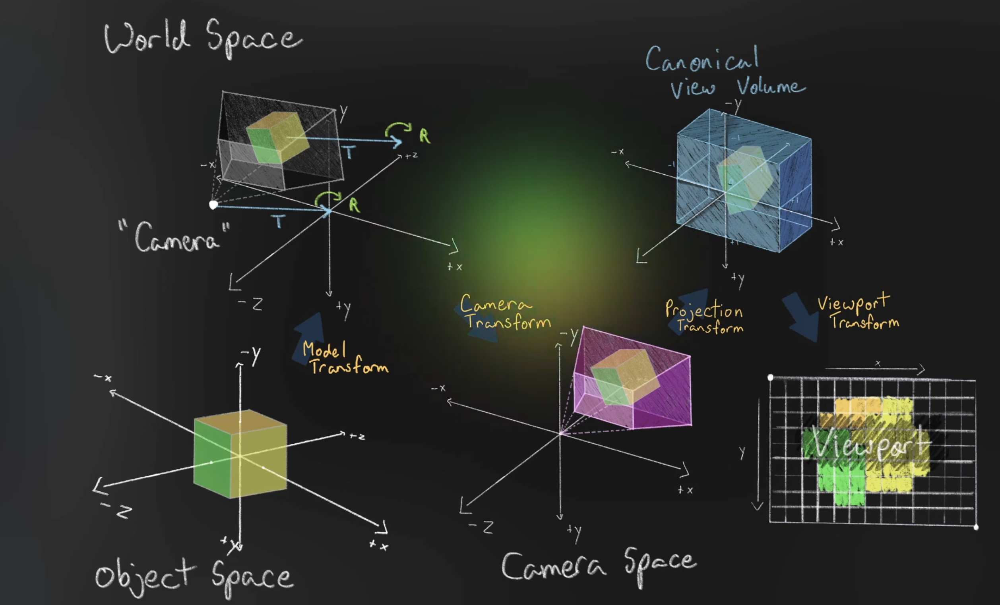

# 相机变换

相机变换 (Camera Transform) 也叫视角变换 (View Transform)，它让我们可以从不同的位置和角度观察场景

在[透视投影](../16.透视投影/README.md#视锥)章节中，我们介绍过视锥

但到目前为止，视锥的角度和位置都是固定的，相机也因此无法在场景中移动

那怎么实现相机变换呢？

## 移动视锥

视锥的顶点就是相机，所以一种直观的做法是把视锥挪到场景中的其他位置——视锥一动，看到的画面自然就变了

不过在渲染时，我们不会真的去移动相机，而是反过来移动整个场景：

1. 平移世界，使相机落到原点
2. 旋转世界，使相机面向 +Z 轴

两步做完，相机就等效于回到了原点、朝 +Z 轴看，这正是[17.透视矩阵](../17.透视矩阵/README.md)里投影所假设的相机位置

描述这个变换的矩阵叫视图矩阵 (View Matrix)，它是相机自身世界变换的逆矩阵

于是顶点需要依次经过模型、视图、投影三次变换：

```
clip = P * V * M * position
```

与上一章的 `P * M` 相比，只是多乘了一个 `V`，顺序依旧是"投影在左、模型在右"

## 视图矩阵

相机除了投影矩阵，还持有一个视图矩阵：

```cpp
class MyCamera {
    public:
        void setOrthographicProjection(
            float left, float right, float top, float bottom, float near, float far);
        void setPerspectiveProjection(float fovy, float aspect, float near, float far);

        void setViewDirection(
            glm::vec3 position, glm::vec3 direction, glm::vec3 up = glm::vec3{0.f, -1.f, 0.f});
        void setViewTarget(
            glm::vec3 position, glm::vec3 target, glm::vec3 up = glm::vec3{0.f, -1.f, 0.f});
        void setViewPosition(glm::vec3 position, glm::vec3 rotation);

        const glm::mat4& getProjectionMatrix() const { return projectionMatrix; }
        const glm::mat4& getViewMatrix() const { return viewMatrix; }

    private:
        glm::mat4 projectionMatrix{1.f};
        glm::mat4 viewMatrix{1.f};
};
```

- **两个矩阵互相独立**：投影决定"怎么压扁"，视图决定"从哪看"，改其中一个不会影响另一个
- **`viewMatrix` 初值为单位阵**：没调用任何 `setView*` 时 `V = I`，退化回上一章"相机在原点朝 +Z"的情形
- **`up` 的默认值是 `(0, -1, 0)`**：屏幕上方对应世界坐标的 -y，与 Vulkan NDC 里 y 轴向下保持一致；若默认给 `(0, 1, 0)`，画面会上下颠倒
- **`getViewMatrix()` 同样返回 `const` 引用**：与 `getProjectionMatrix()` 一个套路，调用方只能读

## 构造正交基

`setViewDirection` 先用两次叉积造出相机的三根轴：

```cpp
void MyCamera::setViewDirection(glm::vec3 position, glm::vec3 direction, glm::vec3 up)
{
  const glm::vec3 w{glm::normalize(direction)};
  const glm::vec3 u{glm::normalize(glm::cross(w, up))};
  const glm::vec3 v{glm::cross(w, u)};

  viewMatrix = glm::mat4{1.f};
  viewMatrix[0][0] = u.x;
  viewMatrix[1][0] = u.y;
  viewMatrix[2][0] = u.z;
  viewMatrix[0][1] = v.x;
  viewMatrix[1][1] = v.y;
  viewMatrix[2][1] = v.z;
  viewMatrix[0][2] = w.x;
  viewMatrix[1][2] = w.y;
  viewMatrix[2][2] = w.z;
  viewMatrix[3][0] = -glm::dot(u, position);
  viewMatrix[3][1] = -glm::dot(v, position);
  viewMatrix[3][2] = -glm::dot(w, position);
}
```

三根轴的几何含义：

| 符号 | 名称 | 方向 | 推导 |
| :--: | :-- | :-- | :-- |
| `w` | 前 (forward) | 相机看向的方向 | `normalize(direction)` |
| `u` | 右 (right) | 屏幕向右 | `normalize(cross(w, up))` |
| `v` | 下 (down) | 屏幕向下 | `cross(w, u)` |

- **`w` 要先归一化**：`direction` 的长度不影响朝向，但后续的 `dot` 与叉积都要求它是单位向量
- **`u` 由 `cross(w, up)` 得到**：`w` 与 `up` 张成"前后-上下"平面，叉积恰好垂直于该平面，也就是左右方向；叉积顺序决定左右的正负，写成 `cross(up, w)` 会让画面左右镜像
- **`v` 不再归一化**：`w`、`u` 已经互相垂直且长度都是 1，它们的叉积长度天然为 1
- **`v` 是"下"而不是"上"**：`v = cross(w, u)` 在 `w = +z`、`u = +x` 时等于 `+y`，而 `+y` 正是屏幕向下；所以传入的 `up` 描述的是"屏幕上方在世界中的方向"，它是 `-v`

`up` 与 `direction` 平行时 `cross(w, up)` 是零向量，`normalize` 会得到 `NaN`，整幅画面随之消失——相机的朝向不能与 `up` 共线

### 默认 `up` 与单位阵

把 `direction` 设为 `(0, 0, 1)`、`up` 用默认的 `(0, -1, 0)`：

```
w = (0, 0, 1)
u = cross(w, up) = cross((0,0,1), (0,-1,0)) = (1, 0, 0)
v = cross(w, u) = cross((0,0,1), (1,0,0)) = (0, 1, 0)
```

代入后旋转部分是单位阵，平移列 `-dot(u, 0)` 等三项全为 0，`V = I`——这正是上一章相机所在的原点位置，说明这套构造在"标准姿态"下不会额外引入任何变换

## 组装视图矩阵

代码里九个元素分成三组，每组是同一根轴的三个分量：

```cpp
viewMatrix[0][0] = u.x;   viewMatrix[1][0] = u.y;   viewMatrix[2][0] = u.z;
viewMatrix[0][1] = v.x;   viewMatrix[1][1] = v.y;   viewMatrix[2][1] = v.z;
viewMatrix[0][2] = w.x;   viewMatrix[1][2] = w.y;   viewMatrix[2][2] = w.z;
```

- **`glm::mat4` 是列主序，`[i][j]` 是第 `i` 列第 `j` 行**：上面三行赋值分别写入第 0 行、第 1 行、第 2 行，所以矩阵的行依次是 `u`、`v`、`w`
- **行是相机的轴**：矩阵前三行依次是 `u`、`v`、`w`，于是 `V·x` 的前三个分量就是 `x` 在三根轴上的投影长度；若把轴排成列 (即写成 `R` 本身)，乘出来的是"相机坐标 → 世界坐标"，方向正好相反
- **平移列 `-dot(u, position)`**：把相机位置 `p` 投影到三根轴上再取负，等价于先旋转 `Rᵀ` 再平移 `-Rᵀp`，即 `V = Rᵀ · T(-p)`
- **`viewMatrix[3][3]` 保持 1**：初始化成单位阵后没再改动，`w` 分量依旧原样传下去
- **不显式求逆**：`glm::inverse` 对 4×4 矩阵要做一般性求逆，而这里只用到"旋转正交 + 平移"的特殊结构，直接填元素既快又不会引入数值误差

代入一个点验证一下：相机在 `p`、朝向 `w`，世界点 `x` 变换后是 `(dot(u, x-p), dot(v, x-p), dot(w, x-p))`——三个分量分别是"该点在相机右边多远、下边多远、前边多远"，正是相机空间坐标的定义

## 三种设置方式

三个接口只是输入形式不同，最终都产出同一个 `V`：

```cpp
void MyCamera::setViewTarget(glm::vec3 position, glm::vec3 target, glm::vec3 up)
{
  setViewDirection(position, target - position, up);
}

void MyCamera::setViewPosition(glm::vec3 position, glm::vec3 rotation)
{
  const float c3 = glm::cos(rotation.z);
  const float s3 = glm::sin(rotation.z);
  const float c2 = glm::cos(rotation.x);
  const float s2 = glm::sin(rotation.x);
  const float c1 = glm::cos(rotation.y);
  const float s1 = glm::sin(rotation.y);
  const glm::vec3 u{(c1 * c3 + s1 * s2 * s3), (c2 * s3), (c1 * s2 * s3 - c3 * s1)};
  const glm::vec3 v{(c3 * s1 * s2 - c1 * s3), (c2 * c3), (c1 * c3 * s2 + s1 * s3)};
  const glm::vec3 w{(c2 * s1), (-s2), (c1 * c2)};
  viewMatrix = glm::mat4{1.f};
  // ... 与 setViewDirection 相同的九项赋值与平移列 ...
}
```

| 接口 | 输入 | 适合的场景 |
| :-- | :-- | :-- |
| `setViewDirection` | 位置 + 朝向 + `up` | 第一人称：直接给定视线方向 |
| `setViewTarget` | 位置 + 目标点 + `up` | 第三人称/环绕：给定"看哪儿" |
| `setViewPosition` | 位置 + 欧拉角 | 复用物体变换的参数体系 |

- **`setViewTarget` 只做一次减法**：`target - position` 就是朝向向量，绕开目标点旋转时只需改 `position`，`target` 保持不动
- **`setViewPosition` 复用[15.欧拉角](../15.欧拉角和齐次坐标/README.md#变换组件)的三个角度**：`u`、`v`、`w` 的表达式与 `TransformComponent::mat4()` 的前三列逐项相同，只是这里把它们当成相机的右、下、前轴
- **两个 `up` 参数都有默认值**：常见的"世界 y 向下"场景不用每次显式传入

### 与模型矩阵互为逆

`setViewPosition(position, rotation)` 产出的 `V`，正好是"平移 `position`、旋转 `rotation`"这个模型矩阵的逆：

```
M = T(position) · R(rotation)
V = Rᵀ · T(-position) = (T(position) · R)⁻¹ = M⁻¹
```

也就是说，把相机当成一个普通物体 (用 `TransformComponent` 摆好)，再对它的世界矩阵取逆，得到的正是视图矩阵。相机"自身怎么放"和"世界怎么反过来动"是同一个变换的两面

## 投影视图合并

渲染系统把两个矩阵先乘成一块，再与模型矩阵相乘：

```cpp
void SimpleRenderSystem::renderGameObjects(
    VkCommandBuffer commandBuffer,
    std::vector<GameObject>& gameObjects,
    MyCamera& camera)
{
  pipeline->bind(commandBuffer);
  auto projectionView = camera.getProjectionMatrix() * camera.getViewMatrix();

  for (auto& obj : gameObjects) {
    // ... 累加旋转角 ...
    SimplePushConstantsData push = {};
    push.color = obj.color;
    push.transform = projectionView * obj.transform.mat4();
    // ... vkCmdPushConstants ...
  }
}
```

- **`projectionView` 提到循环外**：同一帧里所有对象共用同一个 `P * V`，乘一次即可，不必每个对象都重复乘
- **每帧一次、每对象一次**：`P * V` 每帧算一次 (相机可能移动)，`(P * V) * M` 每个对象算一次
- **`(P * V) * M` 与 `P * (V * M)` 结果相同**：矩阵乘法满足结合律，先合并哪两个都不影响最终结果；但先合并 `P`、`V` 能少做 `n - 1` 次乘法
- **推送常量仍是一个 `mat4`**：三次变换被压进同一个矩阵，`SimplePushConstantsData` 的大小与 `vkCmdPushConstants` 的调用都不变
- **相机只读**：参数是 `MyCamera&` 而非 `const MyCamera&`，但函数体内只调用了两个 `const` 的 getter；视图矩阵的更新发生在应用层的 `run()` 里

## 相机姿态与画面

应用层在进入主循环前设置一次相机：

```cpp
MyCamera camera{};
camera.setViewDirection(glm::vec3(0.f), glm::vec3(0.5f, 0.f, 1.f));
```

- **位置在原点、朝向 `(0.5, 0, 1)`**：相当于把相机绕 y 轴向右转了 `atan(0.5) ≈ 26.57°`
- **只调用一次**：相机姿态不随时间变化，每帧变化的只有投影里的宽高比；若把 `setViewDirection` 挪进循环，画面反而会因为朝向被反复重置而看不出移动
- **投影仍在循环内更新**：`setPerspectiveProjection` 依赖窗口尺寸，窗口缩放时必须重新计算

三根轴代入后：

```
w = normalize((0.5, 0, 1)) = (0.447, 0, 0.894)
u = normalize(cross(w, (0, -1, 0))) = (0.894, 0, -0.447)
v = cross(w, u) = (0, 1, 0)
```

把立方体中心 `(0, 0, 2.5)` 变到相机空间：

```
x_cam = dot(u, p) = -1.118
y_cam = dot(v, p) = 0
z_cam = dot(w, p) = 2.236
```

- **`x_cam` 为负，立方体跑到画面左侧**：相机向右转，原本正前方的物体自然移到左边
- **`z_cam` 比 2.5 略小**：2.236 是沿视线方向的投影距离，而不是两点间的欧氏距离
- **NDC 横坐标约 `-0.804`**：`x_cam / (aspect * tanHalfFovy * z_cam)`，代入 `aspect ≈ 1.333`、`tan(25°) ≈ 0.466`，立方体靠近画面左缘但仍完整可见
- **NDC 深度约 `0.965`**：与上一章 `z = 2.5` 时的深度几乎一致，说明偏转视线并不改变深度分布
- **视图矩阵不改变可见范围**：`near`、`far` 与 `fovy` 仍然决定裁剪，`V` 只负责把这些范围"搬到"世界中的另一个位置和朝向上

## 图形渲染管线中的坐标空间与顶点变换总结



在图形渲染管线中，将 3D 模型最终呈现到 2D 屏幕上，需要经历一系列严密的数学坐标系转换。如上图所示，一个顶点的完整渲染旅程主要由四个核心坐标空间和五步关键变换构成，通常统称为 **MVP 变换链路**

1. 物体空间 (Object Space / Local Space)
    * **定义**：模型自身独有的局部坐标系，通常以模型中心或底部为原点 (如图所示左下角的立方体)
    * **意义**：便于 3D 建模软件进行独立的顶点编辑，无需考虑模型在最终场景中的位置。此时坐标空间为 `(x, y, z)`，且 `w = 1`

2. 模型变换 (Model Transform)
    * **作用**：将顶点从局部空间转换到世界空间
    * **实现**：通过**模型矩阵 (Model Matrix, M)** 对顶点施加平移 (Translation)、旋转 (Rotation) 和缩放 (Scale) 操作

3. 世界空间 (World Space)
    * **定义**：包含所有物体和光源的全局坐标系 (如图所示左上角)
    * **意义**：在此空间中，每个物体都拥有了绝对的位置、朝向和大小。如前图所示，立方体被摆放到了场景中的特定位置，与“相机 (Camera)”产生了相对距离

4. 相机变换 (Camera Transform / View Transform)
    * **作用**：将整个世界相对于相机进行移动，通常是将相机固定在原点，并让其朝向 `-Z` 方向观察
    * **实现**：通过**视图矩阵 (View Matrix, V)** 实现
    * **结果**：生成**相机空间 (Camera Space / View Space)** (如图所示下方中间)，此时所有几何体都以相机为绝对参考系，原始的世界坐标系被隐藏

5. 投影变换 (Projection Transform)
    * **作用**：将相机空间中的视锥体 (Frustum)压扁、映射到一个标准的立方体空间中
    * **实现**：通过**投影矩阵 (Projection Matrix, P)** 实现。根据需求分为透视投影 (产生近大远小效果) 和正交投影
    * **结果**：生成**裁剪空间 (Clip Space)**，并紧接着在 GPU 内部执行**透视除法**，最终得到**规范视体 (Canonical View Volume / NDC)** (如图所示右上角)
    * **NDC 特征**：此时所有可见的几何体都被限制在 `x ∈ [-1, 1]`，`y ∈ [-1, 1]`，`z ∈ [0, 1]` (Vulkan 规范) 的标准立方体内。由于坐标经过了透视除法，物体的远近大小比例已经固定

6. 视口变换 (Viewport Transform)
    * **作用**：将标准化的 NDC 坐标映射到最终 2D 屏幕的具体像素坐标上
    * **实现**：由 GPU 的固定功能硬件自动完成。
    * **结果**：生成**屏幕空间/视口空间 (Viewport Space)** (如图所示右下角)。此时，深度信息 (Z) 被送入深度缓冲区进行深度测试，而 X 和 Y 坐标则被映射为光栅化所需的像素网格

* 核心链路公式：**Clip Space = Projection(P) * Model(M) * View(V) * Vertex<sub>Object</sub>**

### 总结

这张图直观地展示了图形学“黑盒”的底层逻辑：从**局部构建** (Object)，到**融入世界** (World)，再到**相机视角** (Camera)，最后降维打击**映射到屏幕像素** (Viewport)。每一次变换，本质上都是一次 4x4 矩阵与齐次坐标的乘法运算
