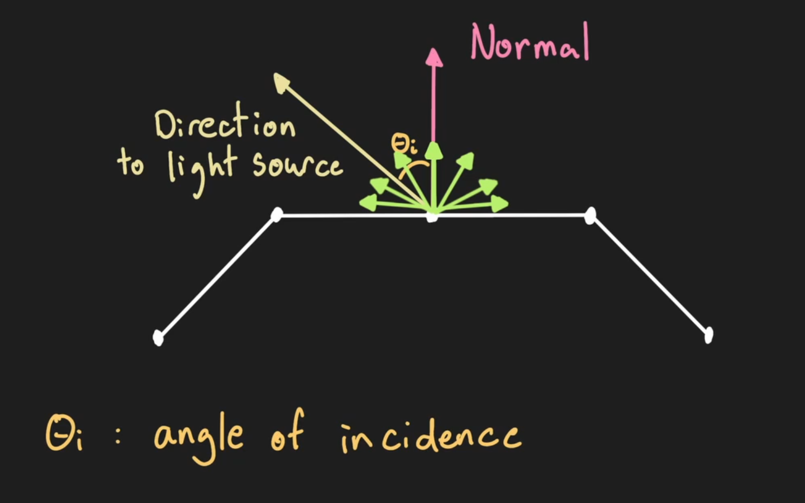
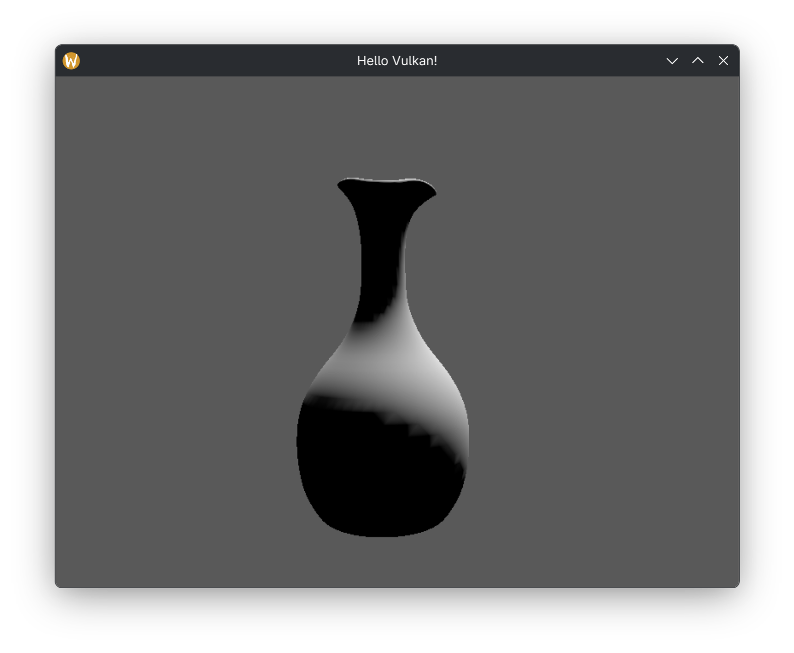
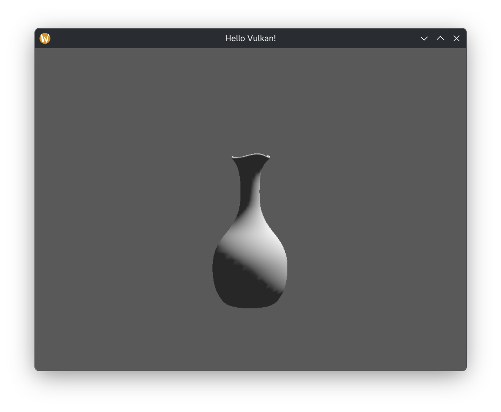

# 漫反射着色

漫反射着色 (Diffuse Shader) 是一种用于模拟物体在不同角度下反射光线的着色器

在渲染过程中，漫反射着色器会针对每个像素，根据物体的法线方向与相机方向，计算出该像素的漫反射颜色

## 光照模型

光照模型是对光传输方程 (Light Transport Equation) 的一种简化，光传输方程如下

$$
L_o(p, \omega_o) = L_e(p, \omega_o) + \int_{S^2} f(p, \omega_o, \omega_i) L_i(p, \omega_i) |\cos \theta_i| d\omega_i
$$

光传输方程决定了光能在场景内的分布、反射与传输方式

这是一个非常复杂的积分方程，会使渲染过程中的计算量变得非常大

因此，我们更常用的是简化后的光照模型

光照模型的计算结果接近光传输方程的结果，但计算量更小，且对 GPU 硬件更友好

### 漫反射光照模型

漫反射光照模型 (Diffuse Model aka Lambertian Model) 便是其中的一种

它假设光源照射到物体表面时，向任意方向反射的光强都相等

这是用于非金属哑光表面 (例如衣物) 的最基础模型

它遵循朗伯余弦定律 (Lambert's Cosine Law)，即反射强度与入射角度的余弦成正比



- `normal`：表面法线方向，即垂直于表面的向量
- `direction to light source`：光源方向，即从表面指向光源的向量
- 这两个向量的夹角就是入射角 $\theta_i$

这两个向量的点积公式为

$$
a \cdot b = \|a\| \|b\| \cos \theta_i
$$

当 $\|a\| = \|b\| = 1$ 时，$a \cdot b = \cos \theta_i$

于是，光源的密度即可由这两个向量的点积表示

当光源垂直于表面时，反射幅度最大

当光源逐渐倾斜、入射角增大时，反射幅度会逐渐减小

### 光照方向与光强

顶点着色器把光照方向写成常量：

```glsl
const vec3 DIRECTION_TO_LIGHT = normalize(vec3(1.0, -3.0, -1.0));
```

- **方向是"从表面指向光源"**：它与顶点位置无关，场景里所有表面共用同一个方向，等价于一个位于无穷远处的方向光
- **方向在世界空间给出**：它不随物体或相机变换，所以和它做点积的法线也必须在世界空间
- **`const` 在编译期求值**：`normalize` 只对常量算一次，运行时没有这条指令
- **`(1, -3, -1)` 的长度是 $\sqrt{11} \approx 3.3166$**，归一化后约为 `(0.3015, -0.9045, -0.3015)`
- **y 分量为负且绝对值最大**：光自上而下入射，x 与 z 各带一点侧向分量，于是朝向 +y 的面背光、朝向 -x 与 -z 的面受光

光强由点积算出，再与顶点颜色相乘：

```glsl
float lightIntensity = AMBIENT + max(dot(normalWorldSpace, DIRECTION_TO_LIGHT), 0.0);

fragColor = lightIntensity * color;
```

- **两个向量都是单位长度**：点积结果就是 $\cos \theta_i$，取值范围 $[-1, 1]$
- **`max(..., 0.0)` 截掉负值**：背光面的余弦为负，直接乘进颜色会让亮度变成负数
- **乘法作用在颜色上**：光强是标量，`lightIntensity * color` 把顶点颜色按比例调亮或压暗，色相不变
- **`color` 来自顶点属性**：每个顶点自带颜色，同一模型的不同面可以有不同颜色

光照计算写在顶点着色器里，所以它是逐顶点光照：

- **`fragColor` 是 `layout(location = 0) out vec3`**：顶点着色器的输出，光栅化阶段在三角形内部按重心坐标线性插值
- **片元着色器不参与计算**：它只有 `layout(location = 0) in vec3 fragColor;` 与 `outColor = vec4(fragColor, 1.0);`，插值结果直接写进颜色附件
- **三角形越小，插值越接近逐像素**：`smooth_vase.obj` 有 5546 个顶点、30888 个面角（10296 个三角形），光斑过渡因此比较平滑；低面数模型上会看到明显的块状渐变

### 顶点法线

法线是顶点数据的一部分，在着色器里按 location 声明：

```glsl
layout(location = 0) in vec3 position;
layout(location = 1) in vec3 color;
layout(location = 2) in vec3 normal;
layout(location = 3) in vec2 uv;
```

对应的属性描述在 C++ 侧给出：

```cpp
std::vector<VkVertexInputAttributeDescription> attributeDescriptions{};
attributeDescriptions.push_back({0, 0, VK_FORMAT_R32G32B32_SFLOAT, offsetof(Vertex, position)});
attributeDescriptions.push_back({1, 0, VK_FORMAT_R32G32B32_SFLOAT, offsetof(Vertex, color)});
attributeDescriptions.push_back({2, 0, VK_FORMAT_R32G32B32_SFLOAT, offsetof(Vertex, normal)});
attributeDescriptions.push_back({3, 0, VK_FORMAT_R32G32_SFLOAT, offsetof(Vertex, uv)});
```

- **聚合初始化的字段顺序是 `location`、`binding`、`format`、`offset`**：四条都用 `push_back` 逐个追加，向量长度就是属性条数
- **`binding` 全是 0**：四条属性都从同一个顶点缓冲的同一个绑定读取
- **`offset` 由 `offsetof` 从 `Vertex` 求得**：分别是 0、12、24、36，与结构体的紧凑布局一致
- **只有 `uv` 是两分量**：格式为 `VK_FORMAT_R32G32_SFLOAT`，其余三项都是 `VK_FORMAT_R32G32B32_SFLOAT`
- **location 与着色器 `in` 一一对应**：管线里声明了 4 条，着色器就必须有 location 0 到 3 的输入
- **`uv` 当前没有被读取**：顶点着色器里没有用到它，编译器会把这条输入优化掉，但属性描述仍然存在，顶点缓冲仍按 `stride` 逐顶点读入
- **法线的长度来自模型文件**：OBJ 的 `vn` 一般已是单位向量，经过模型矩阵后长度会变，所以着色器里还要再 `normalize` 一次

### 法线变换

顶点着色器把法线转到世界空间：

```glsl
vec3 normalWorldSpace = normalize(mat3(push.modelMatrix) * normal);
```

这一行前后有两段注释，讲的是法线变换的两种写法。

第一段注释位于生效的那行上方：

```glsl
// temporary: this only works in certain situations!
// only works correctly if scale is uniform (sx == sy == sz)
// vec3 normalWorldSpace = normalize(mat3(push.modelMatrix) * normal);
```

- **`temporary` 指的是这一行本身**：它是临时方案，只在特定情形下正确，也就是下一句说的均匀缩放
- **`mat3(mat4)` 取左上角 3×3**：等于 `R * S`，列主序下第 0 列被 `scale.x` 乘、第 1 列被 `scale.y` 乘、第 2 列被 `scale.z` 乘
- **法线是方向而不是点**：方向只受线性部分影响，平移不该作用在它身上，所以丢掉第四列；`mat3 * vec3` 相当于把齐次坐标的 w 视为 0，而位置走的是 `push.transform * vec4(position, 1.0)`，w 为 1 让平移生效
- **均匀缩放时缩放被归一化吸收**：`M3 = s * R`，于是 `normalize(s * R * n) = normalize(R * n)`，结果与纯旋转一致
- **非均匀缩放时列被不同比例拉伸**：法线会被拉向缩放较大的那个轴，方向出错

用欧拉角 `(0.6, 0.4, 0.3)` 生成的旋转矩阵实测，同一个法线在两条路径下的偏差为：

| 缩放 | 与正确结果的夹角 |
| :-- | :--: |
| `(3, 3, 3)` | 0° |
| `(2, 1, 1)` | 23.4° |
| `(1, 2, 1)` | 33.2° |

第二段注释给出通用写法：

```glsl
// calculating the inverse in a shader can be expensive and should be avoided
// mat3 normalMatrix = transpose(inverse(mat3(push.modelMatrix)));
// vec3 normalWorldSpace = normalize(normalMatrix * normal);
```

- **正确的法线矩阵是 `M3` 的逆转置**：法线要与表面切线正交，即 `n · t = 0`；切线经 `M3` 变换后，只有让法线走 `(M3⁻¹)ᵀ` 才能保持这个点积为 0
- **对 `R * S` 求逆转置**：`inverse(R * S) = S⁻¹ * Rᵀ`，再转置得 `R * S⁻¹`，也就是旋转部分不变、每列乘 `1 / scale`
- **注释说"在着色器里求逆很贵"**：`inverse` 要算 3×3 的行列式与伴随矩阵，每个顶点都执行一遍；而同一个物体的所有顶点共用同一个模型矩阵，每帧只需在 CPU 上算一次
- **`transpose(inverse(...))` 写成一行是可行的**：GLSL 的 `mat3` 支持这两个内建函数，只是代价放在每个顶点上

`TransformComponent::normalMatrix()` 正是把这个结果在 CPU 上算出来：

```cpp
glm::mat3 TransformComponent::normalMatrix()
{
    const float c3 = glm::cos(rotation.z);
    const float s3 = glm::sin(rotation.z);
    const float c2 = glm::cos(rotation.x);
    const float s2 = glm::sin(rotation.x);
    const float c1 = glm::cos(rotation.y);
    const float s1 = glm::sin(rotation.y);
    const glm::vec3 invScale = 1.0f / scale;

    return glm::mat3{
        {
            invScale.x * (c1 * c3 + s1 * s2 * s3),
            invScale.x * (c2 * s3),
            invScale.x * (c1 * s2 * s3 - c3 * s1),
        },
        {
            invScale.y * (c3 * s1 * s2 - c1 * s3),
            invScale.y * (c2 * c3),
            invScale.y * (c1 * c3 * s2 + s1 * s3),
        },
        {
            invScale.z * (c2 * s1),
            invScale.z * (-s2),
            invScale.z * (c1 * c2),
        },
    };
}
```

- **旋转部分与 `mat4()` 逐元素相同**：同一组欧拉角公式，所以法线矩阵与模型矩阵的旋转完全对齐
- **两处差别**：缩放因子换成 `1.0f / scale`，并且只有 3×3、没有平移列
- **按列组织**：第 0 列整体乘 `invScale.x`、第 1 列乘 `invScale.y`、第 2 列乘 `invScale.z`，正是 `R * S⁻¹`
- **`1.0f / scale` 是分量除法**：得到 `(1/scale.x, 1/scale.y, 1/scale.z)`，`scale` 的任一分量为 0 时结果无效
- **`mat4()` 与 `normalMatrix()` 的实现都放在 `my_game_object.cpp`**：头文件里只留声明，`TransformComponent` 保持轻量
- **这个函数在当前的渲染路径里没有被调用**：`SimpleRenderSystem` 取的是 `obj.transform.mat4()` 的 `mat4` 结果，法线矩阵的 CPU 版本已经备好，但还没有接入推送常量

### 推送常量

两块矩阵通过推送常量传到着色器：

```cpp
struct SimplePushConstantsData {
  glm::mat4 transform{1.f};
  glm::mat4 normalMatrix{1.f};
};
```

```cpp
auto normalMatrix = obj.transform.mat4();
push.transform = projectionView * normalMatrix;
push.normalMatrix = normalMatrix;
```

```glsl
layout(push_constant) uniform Push {
    mat4 transform;
    mat4 modelMatrix;
} push;
```

- **`transform` 是 `P * V * M`**：把顶点从模型空间一路送到裁剪空间，`gl_Position` 直接用它的结果
- **第二块矩阵是模型矩阵 `M`**：只含旋转、缩放、平移，用来把法线转到世界空间
- **不能拿 `transform` 变换法线**：`P * V * M` 含投影与视图，投影会把方向压缩得失真，视图矩阵的平移也不该作用于方向
- **两块各 64 字节，合计 128 字节**：正好等于 Vulkan 规范保证的最小 `maxPushConstantsSize`，再往里加字段就得改用 uniform buffer
- **偏移是 0 与 64**：`mat4` 在 std140 与 std430 里都是 16 字节对齐、64 字节大小，两个字段紧挨着排
- **字段按位置对应，不按名字对应**：C++ 侧第二个字段叫 `normalMatrix`，GLSL 侧叫 `modelMatrix`，类型同为 `mat4`，布局因此一致
- **局部变量是 `mat4` 而非 `mat3`**：`auto normalMatrix = obj.transform.mat4()` 取的是 `mat4()` 的返回值；它先参与 `projectionView * normalMatrix`，再原样写入第二块，同一个矩阵算一次用两次
- **推送常量里没有颜色字段**：颜色完全来自顶点属性 `color`，每个顶点各带一份
- **两个阶段都声明这块**：`pushConstantRange` 的 `stageFlags` 与 `vkCmdPushConstants` 都包含 `VK_SHADER_STAGE_VERTEX_BIT | VK_SHADER_STAGE_FRAGMENT_BIT`；片元着色器里的声明只为保持同一布局，它实际只读 `fragColor`

### 场景设置

`loadGameObjects` 里的变换参数：

```cpp
gameObject.transform.translation = {.0f, .5f, 2.5f};
gameObject.transform.scale = glm::vec3(3.f);
```

- **`glm::vec3(3.f)` 是单参数构造**：三个分量都为 3，即 `(3, 3, 3)`
- **缩放是均匀的**：`sx == sy == sz`，正好满足顶点着色器注释里"只在均匀缩放时正确"的条件
- **模型自身的尺寸被放大三倍**：`smooth_vase.obj` 的包围盒是 `0.204 × 0.4 × 0.204`，放大后约 `0.612 × 1.2 × 0.612`
- **`translation` 抬高到 `y = 0.5`**：模型原本从 `y = -0.4` 延伸到 `y = -0.001`，整体上移后落在原点附近
- **`z = 2.5` 把模型推到相机前方**：相机位于原点附近、朝 +z 观察，透视投影的远平面是 10

## 间接照明 & 环境照明

按漫反射模型渲染时，背对光源的表面会完全变黑



这在视觉上并不自然，因为在现实中，光线还会被墙面等物体反射，再照到物体的背面

只有在真空中，背光面才会完全接收不到光线

这种由其他表面反射而来的照明，被称为间接照明 (Indirect Illumination)

然而，精确计算间接照明需要求解全局光照，计算量极大

环境照明 (Ambient Lighting) 则是一种简单得多的近似手段，用来粗略模拟间接照明的效果



使用环境照明后，物体背对光源的表面会有一个背景颜色，而不是完全变黑

### 环境项的实现

环境照明在着色器里就是一个常量：

```glsl
const float AMBIENT = 0.02;
```

```glsl
float lightIntensity = AMBIENT + max(dot(normalWorldSpace, DIRECTION_TO_LIGHT), 0.0);
```

- **加号的位置在截断之后**：先 `max(..., 0.0)` 让背光面的直接光照归零，再补上 `0.02`，所以背光面不会变成纯黑
- **`lightIntensity` 的取值区间是 `[0.02, 1.02]`**：下限来自环境项，上限是余弦取 1 时再叠加环境项
- **环境项对所有面都生效**：受光面同样加上 `0.02`，因此最亮的表面比纯 `color` 略亮一点
- **`0.02` 意味着背光面保留 2% 的颜色**：`lightIntensity * color` 是标量乘法，背光面的最终颜色约为顶点颜色的 2%
- **它替代了光传输方程里的积分项**：那个对半球方向的积分被压缩成一个常数，这正是"简化模型"的含义
- **环境光是单色的**：常量只调制亮度，不改变色相，所以背光面呈现出的是顶点颜色被压暗后的效果，而不是某种环境色
- **常量与场景无关**：`0.02` 不随物体位置、朝向或相机变化，场景里所有表面共用同一个环境强度

对比两张图可以看出这个常量承担的角色：`indirect_illumination.png` 里背光面接近纯黑，`ambient_lighting.png` 里同样的背光面带上了一层暗色，两者的差别就是这行加法
