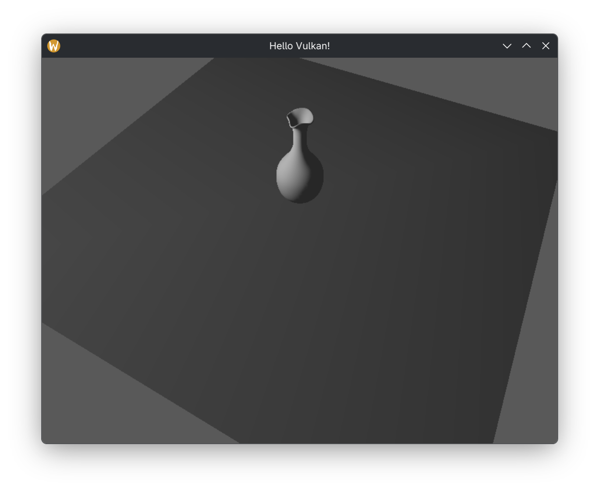
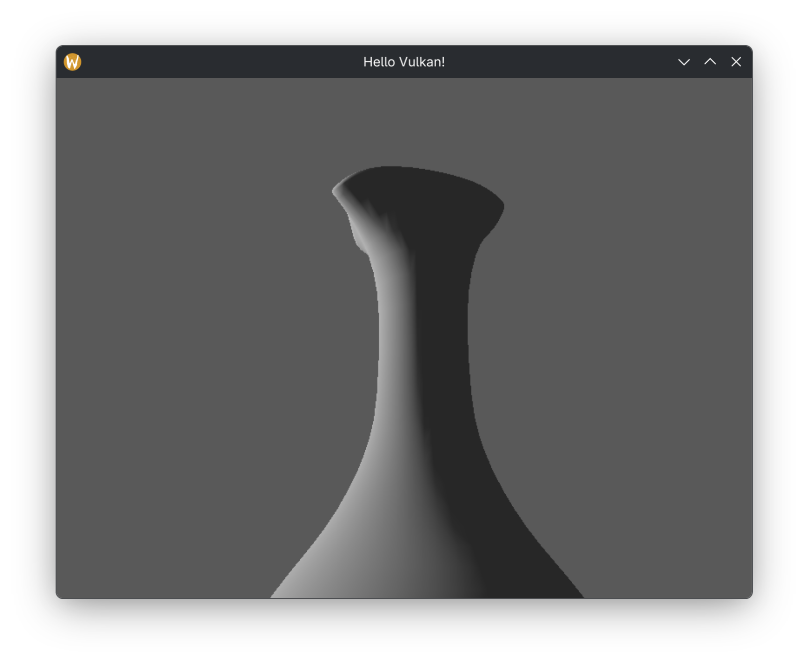
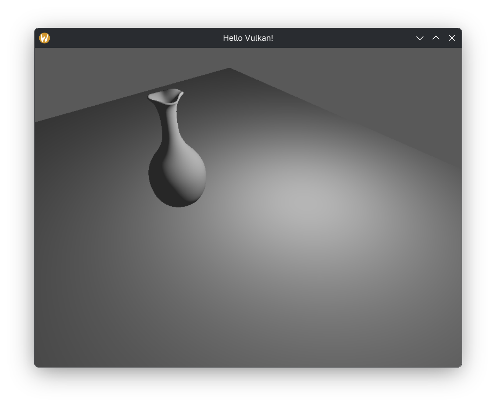
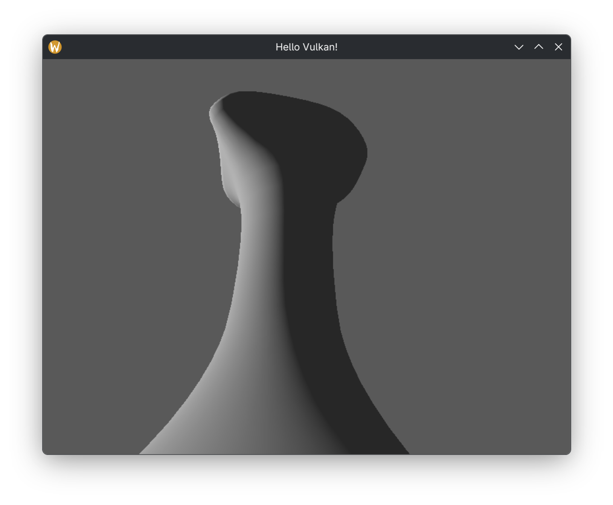

# 逐顶点光照 vs 逐片段光照

在上一章的[点光源](../25.点光源/README.md)中，我们为花瓶模型应用了点光源，不过也留下了一个问题



地板模型非常黑，看上去除了环境光照之外再没有其他光照

这是因为目前的光照是按顶点计算的，而地板只有四个顶点，光照实际上也只在这四个点上计算

相比之下，花瓶的光照看上去是正确的，因为它由多个顶点构成 (例如瓶身的曲面)

因此，一种可能的解决方案是为地板设置更多的顶点，以此来模拟瓶身曲面上的光照

不过，仔细观察花瓶的光照，就会发现它还存在另一个问题



花瓶亮面与暗面的对比非常强烈 (可以看到一条明显的分界线)，而不是渐变过渡

在早期的 3D 渲染中，逐顶点光照是一种常用技术，因为它简单且高效

但在现代的 3D 渲染中，显卡可以轻松处理光照，因此逐片段光照已成为主流技术

## 逐片段光照

逐片段光照 (Per-Fragment Lighting) 是一种在渲染时对每个片段 (Fragment) 都独立计算光照的技术

相比逐顶点光照，它不再只依据顶点上的法线向量，而是把法线向量插值到每个片段上，再据此计算光照

### 顶点与片段

要理解两者的差别，需要先分清顶点和片段各自扮演的角色

顶点是模型本身的几何数据，描述的是三角形网格的拐角，数量取决于模型的精细程度

片段则是光栅化阶段生成的产物：三角形被投影到屏幕上之后，会被切成一个个与像素对齐的小块，每一块就是一个片段

一个顶点通常只对应少数几个三角形，而一个三角形覆盖的区域却可能包含成百上千个片段

片段并不等同于最终像素，只有通过了深度测试、模板测试等环节的片段，才会真正写进颜色附件

每个片段会携带从三角形三个顶点插值而来的数据，例如法线、世界坐标、颜色和纹理坐标

这种插值是透视校正的，也就是说插值权重会按片段的深度做修正，使得远处和近处的三角形都能得到正确的结果

关键差别在于：逐顶点光照插值的是"光照结果"，逐片段光照插值的是"光照输入"

### 为什么逐顶点光照会出问题

光照本身是法线与位置的函数，而且是一个非线性函数：法线需要归一化，漫反射项含有点积与截断，点光源还带有按距离平方反比的衰减

既然是非线性函数，先计算再插值和先插值再计算就不会得到相同的结果，而前者只是后者的近似

近似是否够好，完全取决于三角形有多大：三角形越小，顶点越密，近似就越接近真实值

地板恰好是反例：整个平面只有四个顶点，而光源就悬在上方，四个顶点处的方向、距离都算出来偏暗，插值之后整片地面自然也是一片灰暗

逐顶点光照在这种大三角形上，相当于把整块面的光照"冻结"在四个角落的采样值上，中间的信息完全丢失

花瓶的分界线也是同一原因的另一种表现：漫反射项里的截断让顶点处的亮度在跨过明暗交界时突然从正值掉到零，而线性插值只能在两个顶点之间拉出一条直线，无法还原余弦式的平滑衰减

于是明暗交界就退化成一折一折的直线段，沿着三角形的边分布，看上去就是一条生硬的分界线

此外，逐顶点光照也留不住高光：如果高光恰好落在三角形内部而不在任何顶点上，它就会在插值时被彻底抹平

这种按顶点计算光照、再把颜色插值到片段的做法，通常称为 Gouraud 着色

### 逐片段光照做了什么

逐片段光照的做法是把插值提前到"输入"这一层：顶点着色器只负责把法线、世界坐标等几何数据传给后续阶段，光照计算则推迟到片段着色器

由于每个片段都拿到了属于自己的法线和位置，光照就是逐片段求值，而不是对几个采样值做线性拼接

这正好绕开了非线性函数不能被线性插值逼近的问题：采样点从三角形的三个角变成了每个片段，采样密度与屏幕像素对齐

地板的改善就来自这里：虽然几何上仍然只有四个顶点，但每个片段都用自己的位置去计算到光源的方向和距离衰减，靠近光源下方的片段更亮，远处的片段更暗，于是出现了真正的光斑

花瓶的明暗交界也因此变得连续：截断发生在逐个片段上，亮度可以按余弦规律平滑地衰减到零，不再受三角形边界约束

同理，高光也能落在任意片段上，细节不再受网格密度限制

需要留意的是，插值出来的法线长度一般不再是 1，计算前必须重新归一化，否则点积的结果会偏大，明暗交界的位置会跟着偏移

还有一点容易忽略：逐片段光照改善的只是着色，不改变几何轮廓，花瓶边缘的锯齿状剪影该是什么样还是什么样，那是模型精度和抗锯齿要解决的问题

这种把法线插值到片段、再逐片段求光照的做法，通常称为 Phong 着色

### 代价与取舍

逐片段光照并不是无代价的：片段的数目远多于顶点，光照的整套运算会被重复执行很多次

不过现代显卡的着色能力足以承担这份开销，而且它省去了"为了光照去细分模型"的麻烦，不必增加顶点就能得到更好的效果

逐顶点光照仍有它的位置，例如顶点数量本来就很多、三角形本来就很小的情况，两者结果几乎一致，此时省下片段阶段的开销反而更划算

一些移动端或性能受限的设备也会倾向选择更轻量的方案

### 逐片段光照的实现

光照计算位于片段着色器，顶点着色器只负责把几何数据传出去

#### 顶点着色器的输出

顶点阶段声明三个输出：

```glsl
layout(location = 0) out vec3 fragColor;
layout(location = 1) out vec3 fragPosWorld;
layout(location = 2) out vec3 fragNormalWorld;
```

`main()` 里只做几何变换与数据装填：

```glsl
vec4 positionWorld = push.modelMatrix * vec4(position, 1.0);

gl_Position = ubo.projectionViewMatrix * push.modelMatrix * vec4(position, 1.0);

fragNormalWorld = normalize(mat3(push.normalMatrix) * normal);
fragPosWorld = positionWorld.xyz;
fragColor = color;
```

- **三个输出占据 location 0、1、2**：`fragColor` 是颜色，`fragPosWorld` 是世界坐标，`fragNormalWorld` 是世界法线
- **`fragColor` 直接取顶点属性 `color`**：不含任何光照项，只是把模型自带的颜色往下传
- **`fragPosWorld` 取 `positionWorld.xyz`**：`positionWorld` 只经过 `M` 变换，不含 `P` 与 `V`
- **`fragNormalWorld` 是单位向量**：`normalize(mat3(push.normalMatrix) * normal)` 在写入时就完成了归一化
- **法线矩阵来自推送常量**：`push.normalMatrix` 在 CPU 上算好，着色器只做一次 `mat3` 乘法
- **`gl_Position` 由 `P * V * M` 直接算出**：裁剪坐标与输出变量各自独立计算
- **`ubo` 块在顶点阶段也有声明**：`projectionViewMatrix` 参与 `gl_Position`，其余三个字段由片段阶段读取
- **顶点阶段不含 `directionToLight`、`attenuation`、`lightColor` 等量**：光照相关的一切都在片段阶段

#### 片元着色器的输入与声明

片段阶段声明三个输入，编号与顶点输出对齐：

```glsl
layout(location = 0) in vec3 fragColor;
layout(location = 1) in vec3 fragPosWorld;
layout(location = 2) in vec3 fragNormalWorld;
```

- **`location` 编号与顶点阶段一一对应**：`0` 对颜色、`1` 对世界坐标、`2` 对世界法线
- **数据由光栅化阶段插值**：每个片段拿到的是三个顶点值按透视校正权重混合后的结果
- **插值后法线长度一般不为 1**：三个单位向量按不同权重混合，合向量的长度会小于 1

片段阶段同时声明全局统一缓冲区块：

```glsl
layout(set = 0, binding = 0) uniform GlobalUbo {
    mat4 projectionViewMatrix;
    vec4 ambientLightColor; // w is intensity
    vec3 lightPosition;
    vec4 lightColor;
} ubo;
```

- **块与顶点阶段同名同布局**：四个字段的类型与顺序逐字一致
- **绑定位置是 `set = 0, binding = 0`**：与顶点阶段访问的是同一个描述符集
- **片段阶段读取 `ambientLightColor`、`lightPosition`、`lightColor`**：`projectionViewMatrix` 在这里不参与计算
- **std140 的偏移是 `0 / 64 / 80 / 96`**：与 C++ 侧 `GlobalUbo` 的 112 字节布局对应

推送常量块也在片段阶段声明：

```glsl
layout(push_constant) uniform Push {
    mat4 modelMatrix;
    mat4 normalMatrix;
} push;
```

- **块内容与顶点阶段相同**：两个阶段共用同一份 128 字节范围
- **片段阶段不读取其中任何字段**：`modelMatrix` 与 `normalMatrix` 的作用都止于顶点阶段

#### 片段阶段的光照计算

```glsl
vec3 directionToLight = ubo.lightPosition - fragPosWorld;
float attenuation = 1.0 / dot(directionToLight, directionToLight); // distance squared

vec3 lightColor = ubo.lightColor.xyz * ubo.lightColor.w * attenuation;
vec3 ambientLight = ubo.ambientLightColor.xyz * ubo.ambientLightColor.w;
vec3 diffuseLight = lightColor * max(dot(normalize(fragNormalWorld), normalize(directionToLight)), 0.0);

outColor = vec4((ambientLight + diffuseLight) * fragColor, 1.0); // RGBA比例
```

- **`directionToLight` 由插值后的 `fragPosWorld` 算出**：每个片段都有自己的方向向量
- **`attenuation` 逐片段求值**：`dot(directionToLight, directionToLight)` 是片段到光源的距离平方
- **`normalize(fragNormalWorld)` 在片元阶段执行**：插值把长度拉离 1，点积前必须重新归一化
- **法线共归一化两次**：顶点阶段写入前一次，片段阶段读入后一次
- **`normalize(directionToLight)` 只用于漫反射点积**：衰减项用的是未归一化的平方长度
- **`max(..., 0.0)` 逐片段截断**：亮度在跨越明暗交界时按余弦规律连续衰减
- **`fragColor` 作为颜色输入参与相乘**：光照结果与模型自带颜色结合后写入 `outColor`
- **`outColor` 的 alpha 固定为 1.0**：输出是 RGBA 四分量
- **光照结果直接写入 `outColor`**：片段阶段是管线的最后一级，其后只有颜色写入

#### 描述符集布局的 stageFlags

全局描述符集布局的绑定声明为 `VK_SHADER_STAGE_ALL_GRAPHICS`：

```cpp
auto globalSetLayout = MyDescriptorSetLayout::Builder(device)
  .addBinding(0, VK_DESCRIPTOR_TYPE_UNIFORM_BUFFER, VK_SHADER_STAGE_ALL_GRAPHICS)
  .build();
```

- **片段着色器现在也读 `set = 0, binding = 0` 上的 `GlobalUbo` 块**：它要拿 `ambientLightColor`、`lightPosition`、`lightColor` 算光照，这些字段全部来自这个绑定
- **`stageFlags` 必须覆盖所有访问该绑定的阶段**：它是布局对这个绑定开放的可访问范围，某个阶段不在其中，该阶段对它的访问就没有得到授权
- **只写 `VK_SHADER_STAGE_VERTEX_BIT` 时片段阶段被排除在外**：片段着色器里那句 `ubo.lightPosition` 属于越界访问，校验层会报「描述符集布局的 stageFlags 未包含 FRAGMENT 阶段」一类的错误，运行时读到的是未定义内容
- **顶点阶段本身也离不开这个绑定**：`gl_Position` 依赖 `ubo.projectionViewMatrix`，所以顶点与片段都必须被纳入
- **`VK_SHADER_STAGE_ALL_GRAPHICS` 一次覆盖全部图形阶段**：值为 `0x1F`，含顶点、曲面细分控制、曲面细分求值、几何、片段，无需逐个列举就保证两个使用方都在授权范围内
- **它不含计算阶段**：`VK_SHADER_STAGE_COMPUTE_BIT` 是 `0x20`，不在这五个位里，描述符也不会被计算管线误用

推送常量范围单独声明：

```cpp
pushConstantRange.stageFlags = VK_SHADER_STAGE_VERTEX_BIT | VK_SHADER_STAGE_FRAGMENT_BIT;
pushConstantRange.offset = 0;
pushConstantRange.size = sizeof(SimplePushConstantsData);
```

- **范围覆盖顶点与片段两个阶段**：两个着色器里都声明了 `Push` 块
- **`size` 是 `sizeof(SimplePushConstantsData)`**：两个 `mat4` 共 128 字节
- **`vkCmdPushConstants` 传入的 `stageFlags` 与范围一致**：同一次调用对两个阶段生效
- **推送内容按对象逐个写入**：每个物体的 `modelMatrix` 与 `normalMatrix` 各自一份





可以看到，应用逐片段光照后，地板的光照更加真实，花瓶上明暗之间的分界线也更加平滑

## 游戏对象优化

游戏对象以 ID 为键存放在哈希表里，`FrameInfo` 直接携带这张表

### 类型别名与成员

`GameObject` 内部定义了以 ID 为键的映射类型：

```cpp
using id_t = unsigned int;
using Map = std::unordered_map<id_t, GameObject>;
```

- **键是 `id_t`**：即 `unsigned int`，由 `createGameObject()` 里的静态计数器 `current_id` 递增产生
- **值是 `GameObject` 本身**：不是指针，也不是 `shared_ptr`
- **`Map` 是公开的类型别名**：外部代码可以直接用 `GameObject::Map` 声明变量
- **`#include <unordered_map>` 加在 `my_game_object.hpp` 里**：`Map` 的定义处需要完整类型
- **`getID()` 不是 `const` 成员函数**：调用时对象必须是非 const 的左值

`FirstApp` 的成员声明随之使用这个别名：

```cpp
std::unique_ptr<MyDescriptorPool> globalPool{};
GameObject::Map gameObjects;
```

- **`gameObjects` 的类型是 `GameObject::Map`**：一张从 ID 到对象的哈希表
- **`my_app.hpp` 包含 `my_game_object.hpp`**：`GameObject::Map` 在这里需要完整定义
- **成员顺序是 `globalPool` 在前、`gameObjects` 在后**：注释「order of declarations matters」就写在这两行上方

### 插入对象

`loadGameObjects()` 用 `emplace` 把对象放进表里：

```cpp
gameObjects.emplace(smoothVase.getID(), std::move(smoothVase));
```

```cpp
gameObjects.emplace(floor.getID(), std::move(floor));
```

- **键取自对象自身的 `id`**：`getID()` 返回的编号就是哈希表的键，两者天然一致
- **值通过 `std::move` 移入**：`GameObject` 的移动构造函数是 `default`
- **`GameObject` 没有默认构造函数**：唯一的构造函数是私有的 `GameObject(id_t obj_id)`，因此不能用 `operator[]` 插入
- **移动赋值被 `delete`**：`GameObject &operator=(GameObject &&) = delete;`，表中的值在插入后不能再被赋值
- **拷贝构造与拷贝赋值都被 `delete`**：对象只能移动，不能复制
- **`unordered_map` 的迭代顺序不保证与插入顺序一致**：遍历时的先后顺序取决于哈希分布
- **两个对象各自持有自己的 `model`**：花瓶与地板分别来自 `smooth_vase.obj` 与 `quad.obj`

### FrameInfo 携带对象表

`FrameInfo` 增加一个引用字段：

```cpp
struct FrameInfo {
    int frameIndex;
    float frameTime;
    VkCommandBuffer commandBuffer;
    MyCamera camera;
    VkDescriptorSet globalDescriptorSet;
    GameObject::Map &gameObjects;
};
```

- **最后一个字段是引用**：`GameObject::Map &gameObjects` 直接绑定 `FirstApp` 的成员，不复制表
- **引用字段必须由构造处提供**：聚合初始化时无法省略
- **`frame_info.hpp` 包含 `my_game_object.hpp`**：`GameObject::Map` 需要完整类型
- **`FrameInfo` 每帧在栈上构造一次**：引用成员随 `FrameInfo` 的生命周期有效，指向的对象表始终存在
- **前五个字段依次是 `frameIndex`、`frameTime`、`commandBuffer`、`camera`、`globalDescriptorSet`**：每帧由 `run()` 填入

构造处把成员表传进去：

```cpp
FrameInfo frameInfo{
  frameIndex,
  deltaTime,
  commandBuffer,
  camera,
  globalDescriptorSets[frameIndex],
  gameObjects,
};
```

- **初始化列表末尾是 `gameObjects`**：以左值形式绑定到引用成员
- **`FrameInfo` 在 `beginFrame()` 之后构造**：与帧索引、命令缓冲的获取顺序一致
- **同一个 `frameInfo` 同时传给 `renderGameObjects`**：对象表与描述符集、命令缓冲一并携带

### 渲染系统遍历

渲染系统的签名只接收 `FrameInfo`：

```cpp
void SimpleRenderSystem::renderGameObjects(FrameInfo& frameInfo)
```

```cpp
for (auto& kv_pair : frameInfo.gameObjects) {
  auto& obj = kv_pair.second;
  if (obj.model == nullptr) continue;

  SimplePushConstantsData push = {};
  push.modelMatrix = obj.transform.mat4();
  push.normalMatrix = obj.transform.normalMatrix();

  vkCmdPushConstants(...);
  obj.model->bind(frameInfo.commandBuffer);
  obj.model->draw(frameInfo.commandBuffer);
}
```

- **参数只有 `FrameInfo&`**：对象表通过 `frameInfo.gameObjects` 取得
- **遍历的是哈希表**：`kv_pair.first` 是 ID，`kv_pair.second` 是 `GameObject`
- **`auto& obj = kv_pair.second`**：拿到对象本身的引用，不产生拷贝
- **`obj.model == nullptr` 的条目被跳过**：没有模型的物体不发出绘制命令
- **每个对象单独推送常量**：`modelMatrix` 与 `normalMatrix` 逐物体计算
- **顶点缓冲绑定与绘制调用在循环内**：`bind` 与 `draw` 按对象逐个执行
- **描述符集绑定在循环之外**：全局 UBO 整帧只绑定一次
