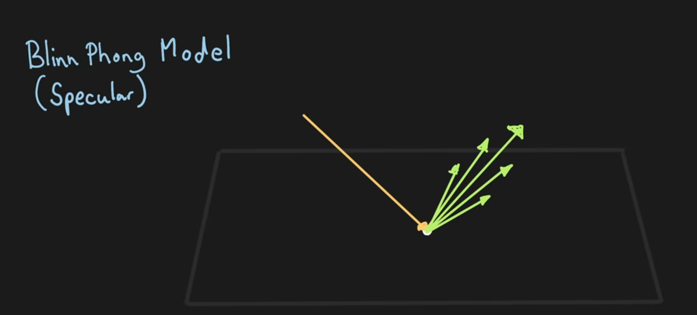
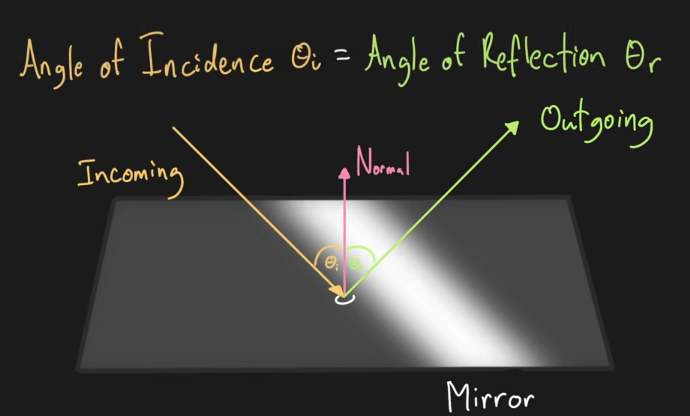

# 镜面光照

在[漫反射着色](../22.漫反射着色/README.md#光照模型)章节中，我们讲解了光照模型是对光传输方程 (Light Transport Equation) 的一种简化

$$
L_o(p, \omega_o) = L_e(p, \omega_o) + \int_{S^2} f(p, \omega_o, \omega_i) L_i(p, \omega_i) |\cos \theta_i| d\omega_i
$$

同时，我们也介绍了[漫反射光照模型](../22.漫反射着色/README.md#漫反射光照模型)，它用于模拟非金属哑光表面 (例如衣物) 的反射行为

而镜面光照 (Specular Lighting) 则用于模拟光滑表面 (例如金属) 的反射行为：反射光不再均匀地散向各个方向，而是集中在镜面反射方向附近

那么，该如何把镜面光照与漫反射光照结合起来使用呢？

## 镜面光照模型

与仅含漫反射项的光照模型相比，加入镜面项后，表面会多出一块明亮的高光 (Highlight)



高光出现在镜面反射方向附近，也就是入射光被表面镜面反射后射出的方向



### 镜面光照模型对比

镜面项本质上是一个关于"视线方向偏离镜面反射方向多少"的函数：偏离越小，反射越强

常见的镜面光照模型有三种

- Phong 光照模型
- Blinn–Phong 光照模型
- Gaussian 光照模型

它们共用同一组向量

- $\mathbf{n}$：表面法线，垂直于表面的单位向量
- $\mathbf{l}$：光源方向，从表面指向光源的单位向量
- $\mathbf{v}$：视线方向，从表面指向相机的单位向量
- $\mathbf{r}$：镜面反射方向，即 $\mathbf{l}$ 关于 $\mathbf{n}$ 的反射，$\mathbf{r} = 2(\mathbf{n} \cdot \mathbf{l})\mathbf{n} - \mathbf{l}$
- $\mathbf{h}$：半程向量 (Half Vector)，即 $\mathbf{l}$ 与 $\mathbf{v}$ 的角平分方向，$\mathbf{h} = \text{normalize}(\mathbf{l} + \mathbf{v})$

三种模型的镜面项分别是

$$
L_{\mathrm{Phong}} = k_s \, L_i \, (\mathbf{r} \cdot \mathbf{v})^p
$$

$$
L_{\mathrm{Blinn}} = k_s \, L_i \, (\mathbf{n} \cdot \mathbf{h})^p
$$

$$
L_{\mathrm{Gaussian}} = k_s \, L_i \, e^{-(\theta / \sigma)^2}
$$

- **$k_s$ 是高光反射率**：表面越光滑、越接近金属，这个值越大
- **$L_i$ 是入射光强**：与漫反射项取自同一个光源
- **$p$ 是高光指数 (Shininess)**：越大高光越锐利、覆盖范围越小
- **$\theta$ 是视线方向与镜面反射方向的夹角**，$\sigma$ 控制 Gaussian 高光的宽度

| 模型 | 比较的对象 | 高光边缘 | 每个片元的额外开销 |
| :-- | :-- | :-- | :-- |
| Phong | 反射方向 $\mathbf{r}$ 与视线 $\mathbf{v}$ | 余弦为负处被截断 | 求 $\mathbf{r}$ 并归一化 |
| Blinn–Phong | 半程向量 $\mathbf{h}$ 与法线 $\mathbf{n}$ | 余弦为负处被截断，同指数下更宽 | 一次归一化 |
| Gaussian | 反射方向与视线的夹角 $\theta$ | 平滑衰减、无截断 | 指数运算与夹角求解 |

#### Phong VS Blinn–Phong

两种写法其实描述的是同一个高光，只是换了比较对象

- **两者可以互相换算**：令 $\theta$ 为视线与镜面反射方向的夹角，则 $\mathbf{r} \cdot \mathbf{v} = \cos \theta$，而 $\mathbf{n} \cdot \mathbf{h} = \cos(\theta / 2)$，并且恒有 $\mathbf{r} \cdot \mathbf{v} = 2(\mathbf{n} \cdot \mathbf{h})^2 - 1$
- **相同指数下 Blinn–Phong 的高光更宽**：Phong 项按 $\cos^p \theta$ 衰减，Blinn–Phong 项按 $\cos^p(\theta / 2)$ 衰减，后者衰减得更慢
- **想让两者高光大小接近，指数相差约 4 倍**：Blinn–Phong 的 $p$ 大致取 Phong 的 4 倍时，高光宽度才相当
- **Blinn–Phong 少一步计算**：不必显式求出 $\mathbf{r}$，`reflect` 加一次归一化被 $\mathbf{l} + \mathbf{v}$ 的一次归一化取代
- **Blinn–Phong 有退化情形**：当 $\mathbf{l} + \mathbf{v} \approx \mathbf{0}$，即光源几乎位于相机背后时，$\mathbf{h}$ 无法定义，高光会突然消失
- **Phong 的余弦可能为负**：视线偏到镜面反射方向的反侧时 $\mathbf{r} \cdot \mathbf{v} < 0$，需要 `max(..., 0.0)` 截断，否则会算出负的光强

#### Blinn–Phong VS Gaussian

- **Gaussian 没有硬边界**：$\theta$ 增大时指数平滑地衰减到 0，不会在某个角度突然截断
- **Gaussian 的高光形状更接近物理模型**：钟形分布与基于微表面分布的 BRDF（例如 Beckmann）形状相似，高光中心到边缘的过渡更自然
- **Gaussian 需要指数运算**：还要先得到夹角 $\theta$；直接 `acos` 求角度很贵，实践中常用小角度近似 $\theta^2 \approx 2(1 - \mathbf{r} \cdot \mathbf{v})$ 来避免
- **Blinn–Phong 代价最低**：只需点积与乘方，因此在实时渲染中用得最多

## 与漫反射光照的结合

光照模型的各个部分之间是叠加关系，而不是互相替代

$$
L_o = L_{\mathrm{ambient}} + L_{\mathrm{diffuse}} + L_{\mathrm{spec}}
$$

- **环境项是常量**：近似间接照明，保证背光面不会变成纯黑
- **漫反射项与视线无关**：按朗伯余弦定律计算，描述表面的基础颜色
- **镜面项只在镜面反射方向附近有值**：描述随视角移动的高光
- **三者相加**：同一个表面既有哑光底色，也有随视角滑动的高光；哑光感主要来自漫反射项，金属感主要来自镜面项
- **两者的比例可以再分配**：用菲涅耳 (Fresnel) 项或金属度 (Metallic) 参数，按视角与材质调整镜面项与漫反射项的权重

下面示例采用 Blinn–Phong 模型：片元着色器不求反射方向 `reflect(...)`，而是先算出半程向量 `h = normalize(l + v)`，再用 `dot(n, h)` 的 512 次幂得到高光强度

## 逆视图矩阵

镜面项需要视线方向，而视线方向要先知道相机在世界空间中的位置，`GlobalUbo` 的第三个字段 `inverseView` 保存的就是这份信息：

```cpp
struct GlobalUbo {
  glm::mat4 projection{1.f};
  glm::mat4 view{1.f};
  glm::mat4 inverseView{1.f};
  glm::vec4 ambientLightColor{1.f, 1.f, 1.f, .02f}; // w is intensity
  PointLight pointLights[MAX_LIGHTS];
  int numLights;
};
```

- **`inverseView` 紧跟在 `view` 之后**：字段顺序是 `projection`、`view`、`inverseView`、`ambientLightColor`、`pointLights`、`numLights`
- **实测偏移是 0、64、128、192、208、528**：依次对应上述六个字段
- **`sizeof(GlobalUbo)` 为 532**：std140 的块大小按 16 字节取整是 544，末尾 12 字节没有任何字段
- **UBO 缓冲区按 `sizeof(GlobalUbo)` 分配**：`MyBuffer` 构造时传入的就是这个值
- **三个 `mat4` 连续排列**：每个占 64 字节，中间没有填充

四个着色器的 `GlobalUbo` 声明在 `view` 之后都写着 `mat4 inverseView;`：

```glsl
layout(set = 0, binding = 0) uniform GlobalUbo {
    mat4 projection;
    mat4 view;
    mat4 inverseView;
    vec4 ambientLightColor; // w is intensity
    PointLight pointLight[10];
    int numLights;
} ubo;
```

- **声明出现在 `simple_shader.vert`、`simple_shader.frag`、`point_light.vert`、`point_light.frag`**：四个着色器共用 `set = 0, binding = 0`，块布局必须逐字段一致
- **只有 `simple_shader.frag` 读取 `inverseView`**：其余三个着色器声明了字段但不访问
- **字段名是 `inverseView`**：与 C++ 侧的 `inverseView` 同名

## 相机维护逆视图矩阵

`MyCamera` 保存一份逆视图矩阵，并给出只读访问器：

```cpp
const glm::mat4& getProjectionMatrix() const { return projectionMatrix; }
const glm::mat4& getViewMatrix() const { return viewMatrix; }
const glm::mat4& getInverseViewMatrix() const { return inverseViewMatrix; }

private:
    glm::mat4 projectionMatrix{1.f};
    glm::mat4 viewMatrix{1.f};
    glm::mat4 inverseViewMatrix{1.f};
```

- **三个矩阵各占一个成员**：`projectionMatrix`、`viewMatrix`、`inverseViewMatrix`
- **访问器返回 `const glm::mat4&`**：不复制矩阵，直接引用成员
- **成员初值都是单位矩阵**：`{1.f}` 走 `glm::mat4` 的单标量构造

`setViewDirection` 与 `setViewPosition` 在写完视图矩阵后紧接着构造逆矩阵：

```cpp
inverseViewMatrix = glm::mat4{1.f};
inverseViewMatrix[0][0] = u.x;
inverseViewMatrix[0][1] = u.y;
inverseViewMatrix[0][2] = u.z;
inverseViewMatrix[1][0] = v.x;
inverseViewMatrix[1][1] = v.y;
inverseViewMatrix[1][2] = v.z;
inverseViewMatrix[2][0] = w.x;
inverseViewMatrix[2][1] = w.y;
inverseViewMatrix[2][2] = w.z;
inverseViewMatrix[3][0] = position.x;
inverseViewMatrix[3][1] = position.y;
inverseViewMatrix[3][2] = position.z;
```

- **旋转部分是视图矩阵旋转部分的转置**：视图矩阵把 `u`、`v`、`w` 写在列上（`viewMatrix[0][0] = u.x`、`viewMatrix[1][0] = u.y`、`viewMatrix[2][0] = u.z`），逆矩阵把它们写在行上（`inverseViewMatrix[0][0] = u.x`、`inverseViewMatrix[0][1] = u.y`、`inverseViewMatrix[0][2] = u.z`）
- **平移部分直接是相机位置**：`inverseViewMatrix[3]` 的三个分量分别填 `position.x`、`position.y`、`position.z`；视图矩阵同一列填的是 `-dot(u, position)`、`-dot(v, position)`、`-dot(w, position)`
- **`[3][3]` 保持 1**：由 `glm::mat4{1.f}` 的初值提供
- **没有调用 `glm::inverse`**：正交基的转置就是逆，逐分量赋值即可
- **两个函数各写一份**：`setViewDirection` 与 `setViewPosition` 分别构造各自的 `u`、`v`、`w`，随后都执行同一段赋值
- **`setViewTarget` 不含这段代码**：它把参数交给 `setViewDirection` 处理

帧循环里把逆矩阵写进 UBO：

```cpp
GlobalUbo ubo{};
ubo.projection = camera.getProjectionMatrix();
ubo.view = camera.getViewMatrix();
ubo.inverseView = camera.getInverseViewMatrix();

pointLightSystem.update(frameInfo, ubo);
```

- **赋值在 `pointLightSystem.update` 之前**：`update` 只填 `pointLights` 与 `numLights`，不碰这三个矩阵
- **三个矩阵来自同一帧的 `camera`**：由 `getProjectionMatrix()`、`getViewMatrix()`、`getInverseViewMatrix()` 取出
- **写入发生在 `writeToBuffer` 之前**：`uboBuffers[frameIndex]->writeToBuffer(&ubo)` 取到的是填好的整份结构

## 片元着色器中的镜面项

镜面项按 Blinn–Phong 计算，累加进独立的 `specularLight`：

```glsl
void main() {
    vec3 diffuseLight = ubo.ambientLightColor.xyz * ubo.ambientLightColor.w;
    vec3 specularLight = vec3(0.0);
    vec3 surfaceNormal = normalize(fragNormalWorld);

    vec3 cameraPosWorld = ubo.inverseView[3].xyz;
    vec3 viewDirection = normalize(cameraPosWorld - fragPosWorld);

    for (int i = 0; i < ubo.numLights; i++) {
        PointLight light = ubo.pointLight[i];
        vec3 directionToLight = light.position.xyz - fragPosWorld;
        float attenuation = 1.0 / dot(directionToLight, directionToLight); // distance squared
        directionToLight = normalize(directionToLight);

        float cosAngIncidence = max(dot(surfaceNormal, normalize(directionToLight)), 0.0);
        vec3 intensity = light.color.xyz * light.color.w * attenuation;

        diffuseLight += intensity * cosAngIncidence;

        // specular lighting
        vec3 halfAngle = normalize(directionToLight + viewDirection);
        float blinnTerm = dot(surfaceNormal, halfAngle);
        blinnTerm = clamp(blinnTerm, 0.0, 1.0);
        blinnTerm = pow(blinnTerm, 512.0); // higher values -> sharper highlight
        specularLight += intensity * blinnTerm;
    }

    outColor = vec4((diffuseLight + specularLight) * fragColor, 1.0); // RGBA比例
}
```

- **`cameraPosWorld` 取 `ubo.inverseView[3].xyz`**：`[3]` 是矩阵的第四列，其前三个分量正是相机构造逆矩阵时填入的 `position`
- **`viewDirection` 从表面指向相机**：`cameraPosWorld - fragPosWorld` 归一化后得到 $\mathbf{v}$
- **视线方向在循环外算一次**：整个片元的相机位置相同，不必逐光源重复
- **`surfaceNormal` 在循环外归一化一次**：循环内每个光源复用同一个法线
- **`attenuation` 用的是未归一化的向量**：`dot(directionToLight, directionToLight)` 即距离平方，随后才对 `directionToLight` 归一化
- **`cosAngIncidence` 对已归一化的向量再调一次 `normalize`**：`normalize(directionToLight)` 作用在上一行刚归一化的结果上，取值不变
- **`intensity` 同时供漫反射项与镜面项使用**：`light.color.xyz * light.color.w * attenuation`
- **`halfAngle` 是 $\mathbf{h}$**：`normalize(directionToLight + viewDirection)` 即 $\mathbf{l} + \mathbf{v}$ 的角平分方向
- **`blinnTerm` 是 $\mathbf{n} \cdot \mathbf{h}$**：`dot(surfaceNormal, halfAngle)`
- **`clamp(blinnTerm, 0.0, 1.0)` 保证底数为非负且不超过 1**：`pow` 对负底数的结果未定义，截断后高光背面直接为 0
- **指数是字面量 `512.0`**：注释写明数值越大高光越锐利
- **`specularLight` 从 `vec3(0.0)` 起累加**：`specularLight += intensity * blinnTerm`
- **镜面项没有单独的反射率系数**：`intensity` 与漫反射项完全相同，高光强度只由材质颜色与指数决定
- **最终颜色是两项之和**：`(diffuseLight + specularLight) * fragColor`
- **`diffuseLight` 的初值是环境光**：`ambientLightColor.xyz * ambientLightColor.w`，环境项不参与镜面累加
